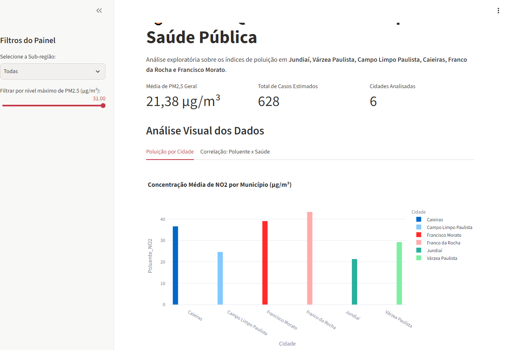
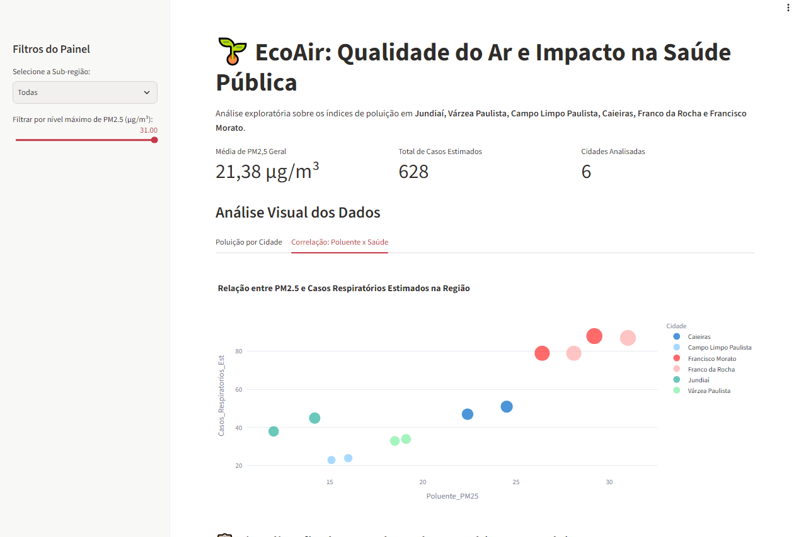

# 🌱 EcoAir: Monitoramento da Qualidade do Ar e Impacto na Saúde Pública

## 📌 Tema e Justificativa
O **EcoAir** é um dashboard interativo desenvolvido para monitorar e analisar os índices de poluição atmosférica — especificamente Material Particulado Fino (**PM2.5**) e Dióxido de Nitrogênio (**NO2**) — em municípios da **Aglomeração Urbana de Jundiaí** (Jundiaí, Várzea Paulista e Campo Limpo Paulista) e da **Região Metropolitana de São Paulo** (Caieiras, Franco da Rocha e Francisco Morato).

A escolha do tema justifica-se pela relevância da qualidade do ar na saúde pública regional, uma vez que essas cidades possuem intenso fluxo rodoviário, atividade industrial e alta densidade populacional, fatores diretamente associados à incidência de doenças respiratórias.

---

## 🔌 Fonte de Dados (API)
* **API Utilizada:** [Open-Meteo Air Quality API](https://open-meteo.com) (API pública e gratuita de monitoramento atmosférico).
* **Descrição dos Dados:** Os dados foram coletados via requisições HTTP (`requests`) utilizando as coordenadas geográficas (latitude e longitude) de cada município. As principais variáveis analisadas são:
  * `Data` / `Data_Hora`: Registro temporal das medições.
  * `Cidade` e `Regiao`: Identificação do município e sub-região administrativa.
  * `Poluente_PM25`: Concentração de partículas inaláveis finas em **µg/m³**.
  * `Poluente_NO2`: Concentração de dióxido de nitrogênio em **µg/m³**.
  * `Status_Qualidade`: Classificação gerada no tratamento com base nos parâmetros da OMS (*Boa*, *Moderada* ou *Ruim*).
  * `Casos_Respiratorios_Est`: Estimativa de impacto/atendimentos respiratórios associada ao nível de exposição regional.

---

## ❓ Perguntas-Chave
O dashboard foi projetado para responder às seguintes questões:
1. **Qual é a média atual de poluentes (PM2.5 e NO2) nos municípios analisados e como ela se compara aos limites recomendados pela OMS?**
2. **Existem diferenças significativas nos níveis de poluição entre a AU de Jundiaí e os municípios vizinhos da Grande São Paulo?**
3. **Como a concentração de material particulado (PM2.5) se relaciona com a estimativa de casos respiratórios na região?**

---

## ⚙️ Como Rodar o Projeto Localmente

### Pré-requisitos
* Python 3.9 ou superior instalado.

### Passo a passo
1. **Clone o repositório:**
   ```bash
   git clone https://github.com
   cd ecoair-dashboard
   ```

2. **Instale as dependências:**
   ```bash
   pip install -r requirements.txt
   ```

3. **(Opcional) Atualize os dados da API e execute o tratamento:**
   ```bash
   python coleta.py
   python tratamento.py
   ```

4. **Execute o dashboard Streamlit:**
   ```bash
   streamlit run app.py
   ```

5. Acesse no navegador o endereço local exibido no terminal (`http://localhost:8501`).

---

## 📊 Capturas de Tela e Contexto

### 1. Visão Geral, KPIs e Comparativo por Cidade

*Contexto: Apresenta os indicadores-chave de desempenho (média de PM2.5, total de casos estimados e municípios analisados), os filtros interativos na barra lateral (sub-região e limite máximo de PM2.5) e o gráfico de barras comparando a concentração de NO2 por município.*

### 2. Correlação entre Poluição e Saúde Pública

*Contexto: Gráfico de dispersão que evidencia a relação positiva entre o aumento da concentração de PM2.5 e os casos respiratórios estimados em cada cidade, acompanhado da tabela de dados processados.*

---

## 👥 Integrantes do Grupo
Nome Célio Cipriano Braz


